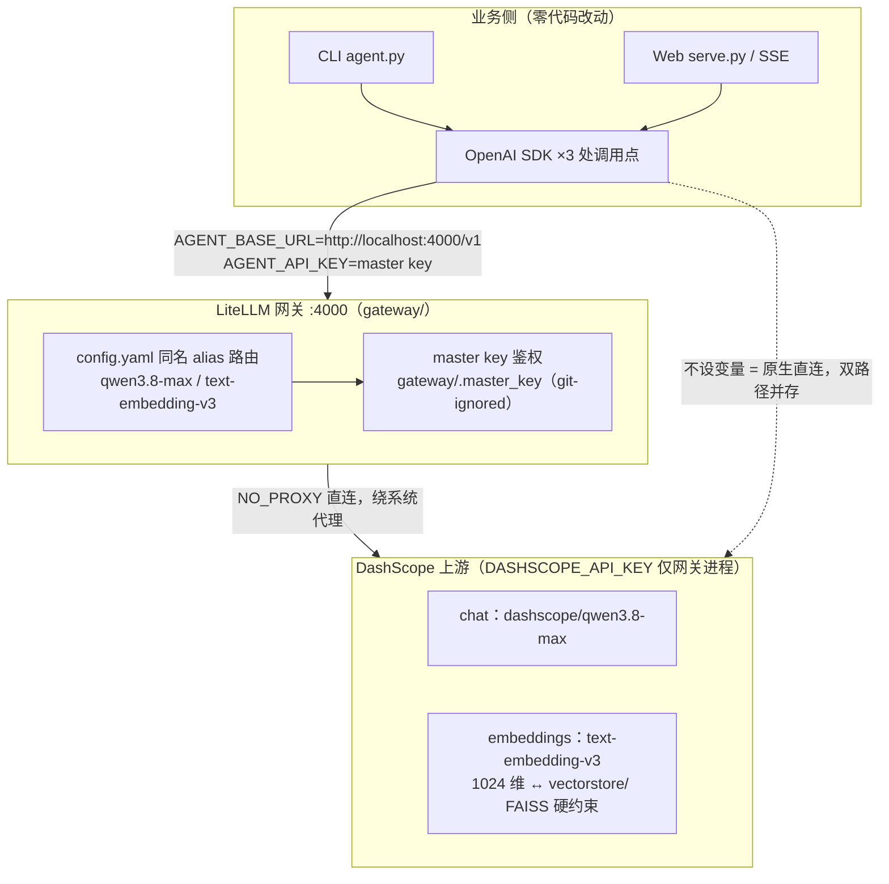

# stock-agent

以 A 股金融分析为真实场景的 **ReAct（Reasoning + Acting）Agent **：
LLM 驱动 Thought → Action → Observation 循环，逐步调用工具完成财务对比、
年报深度检索、股价与技术面分析、舆情追踪、行业横向对比等任务，
最终自动产出一份结构化 Markdown 研报。

**为什么值得读这个仓库** —— 一个刻意"不用框架"的 Agent 工程：

- 🧠 **双实现可对照学习**：同一套工具、同一份评估脚本，跑两种推理范式——
  手写 Prompt 解析版（Thought/Action 格式约束 + 正则解析，模型每步"想了什么"完全透明）
  vs Function Calling 版（`tool_calls` API 原生能力，格式鲁棒性由 SDK 保证）。
  从第一行代码看清 Agent 循环本质，而非 LangChain/AutoGen 的框架黑箱
- 🔌 **真实数据而非玩具数据**：8 个工具打通 4 类数据源——DashScope Embedding +
  FAISS 年报向量检索（5 家公司 2021-2023 年报、10353 条向量）、AkShare 实时财务
  指标/行情/技术指标/新闻/行业成分、受限计算器、防幻觉公司映射
- 🛡️ **生产级健壮性**：区分 demo 与工程的正是这些不受欢迎的部分——
  网络异常 3 次重试 + 代理失效自动直连、工具结果 TTL 缓存（防击穿/错误不缓存/
  LRU 有界）、随时协作式打断（页面刷新级联取消）、LLM 欠费/限流/超时友好降级
- 🔍 **全链路可观测**：DeepSeek 风格思考抽屉实时展开每步推理、每步耗时埋点、
  每轮缓存命中统计、自动生成含推理链表格的研报，`evaluate.py` 双实现对比一键复现
- 💬 **多轮对话记忆**：session 隔离的短期记忆，追问"再算第一家"也能接住上下文

> 仅供学习研究使用，不构成任何投资建议。

## 功能特性

- ReAct 循环驱动（默认最多 10 步），支持 CLI 与 Web UI（SSE 流式展示每步推理）
- **8 个异构工具**：
  | 工具 | 数据来源 | 用途 |
  |------|---------|------|
  | `company_lookup` | 静态字典 | 公司名 → 股票代码，防幻觉 |
  | `rag_search` | FAISS + DashScope Embedding | 年报原文语义检索（5 家公司 2021–2023 年报，10353 条向量） |
  | `financial_indicator` | AkShare | 近 3 年结构化财务指标 |
  | `stock_price` | AkShare | 历史股价与区间涨跌幅 |
  | `technical_indicator` | AkShare + pandas | MA 均线 / RSI14 / MACD，自动提示金叉死叉 |
  | `news_search` | AkShare（东方财富） | 个股近期新闻资讯 |
  | `industry_peers` | AkShare（东方财富） | 所属行业与行业内主要可比公司 |
  | `calculator` | 受限 Python eval | 四则运算、百分比、CAGR |
- **自动研报**：每次分析结束后自动生成结构化 Markdown 研报（结论 / 推理链表格（含每步耗时）/ 数据来源 / 局限性），Web UI 一键下载，CLI 支持 `--save-report`
- 同一 Agent、同一问题，工具组合路径因模型自主决策而不同，便于观察推理行为
- **Web UI（DeepSeek 风格思考抽屉）**：运行中实时展开推理步骤、结束后自动收起只留结论；支持随时 ⏹ 停止打断；每步显示耗时
- 网络异常自动重试：系统代理失效时自动直连兜底，对 LLM 返回简洁错误描述
- **LLM/embedding 默认直连**：DashScope/DeepSeek 为国内端点，默认绕过系统代理（代理抖动是 TLS 握手超时的常见根源），`AGENT_TRUST_SYSTEM_PROXY=1` 可改回走代理；LLM 请求超时/断线自动重试一次
- **工具结果缓存**：6 个网络型工具带进程内 TTL+LRU 缓存（财务指标 1h / 行情 15min / 新闻 5min），同轮重复调用瞬时返回（实测 1.5s → 0.1ms），并防缓存击穿、错误结果不缓存；`--no-cache` / `TOOL_CACHE_DISABLE=1` 可旁路

## 架构

```
┌─────────────────┐      ┌────────────────────────────────────┐
│   CLI agent.py  │      │        Web UI  index.html          │
│ --mode/fc/交互   │      │ 思考抽屉 · ⏹停止 · 每步耗时 · 研报导出 │
└────────┬────────┘      └──────────────┬─────────────────────┘
         │ 函数级调用（同进程）            │ HTTP：SSE 流式 / 打断 / 缓存管理
         ▼                              ▼
┌───────────────── FastAPI  serve.py ──────────────────────────────┐
│  接口: /query/{mode}(SSE)  /cancel/{qid}  /cache/stats|clear     │
│        /report/{file}·latest  /health(含缓存状态)                 │
│                                                                  │
│  ┌──────────────────  ReAct 引擎层  ───────────────────────┐     │
│  │  react_manual.py  ·  react_function_calling.py          │     │
│  │   Thought ──▶ Action ──▶ Observation ──┐                 │     │
│  │      ▲ LLM调用前/工具执行前  检查取消    │ 循环(≤10步,计时) │     │
│  │      └────────────────────────────────┘                │     │
│  └─────────────────────────────────────────────────────────┘     │
│   短期记忆（session 隔离·reset 控制）  ·  final → 自动生成研报       │
└──────────┬───────────────────────────────────────┬──────────────┘
           ▼                                       ▼
┌────────────────────────────┐      ┌─────────────────────────────┐
│   tools.py  ：  8 个工具     │      │   LLM / Embedding 客户端      │
│  调用链（自上而下）:          │      │   DashScope qwen3.8-max      │
│   @_with_cache  TTL+LRU 缓存 │      │   trust_env=False 直连       │
│   （命中=零网络·防击穿·       │      │   _llm_create 超时/断线重试   │
│    错误不缓存·异常降级直连）   │      │   AGENT_TRUST_SYSTEM_PROXY=1 │
│   @_with_retry  3次重试      │      │   可改回系统代理              │
│   （第2次起绕过代理直连）      │      └─────────────────────────────┘
│  ┢company_lookup  静态字典    │
│  ┢calculator      受限eval   │      ┌─────────────────────────────┐
│  ┢rag_search      FAISS+嵌入  │      │  评估/产出物                  │
│  ┢financial_indicator…AkShare│      │  evaluate.py 双实现对比       │
│  ┢stock_price·technical·news │      │  report.py  Markdown 研报    │
│  ┢industry_peers             │      └─────────────────────────────┘
└────────────────────────────┘
```

核心链路一句话：**用户 → serve.py（SSE/打断/缓存管理）→ ReAct 引擎（取消检查点 + 计时）→ 工具管线（缓存 → 重试 → 数据源）+ LLM（直连重试）→ SSE 流式推送 → 结论卡片 + 自动研报**。

## 目录结构

```
stock-agent/
├── src/
│   ├── tools.py                  # 8 个工具实现 + 网络重试 + 进程内 TTL 缓存
│   ├── react_manual.py           # 手写 Prompt 解析版 ReAct
│   ├── react_function_calling.py # Function Calling 版 ReAct
│   ├── agent.py                  # 统一 CLI 入口（--mode manual/fc，--save-report）
│   ├── report.py                 # Markdown 研报生成器
│   ├── evaluate.py               # 两种实现对比评估
│   └── serve.py                  # FastAPI 服务（含研报下载接口）
├── vectorstore/
│   ├── faiss_index.bin           # FAISS 索引（1024 维，10353 条）
│   └── faiss_meta.json           # 向量 chunk 元数据
├── models/
│   └── bge-small-zh-v1.5/        # 本地 embedding 模型（备用）
├── evaluation/
│   └── compare_result.json       # 对比评估结果示例
├── gateway/                      # LLM 网关（LiteLLM Proxy，可选）
│   ├── config.yaml               #   模型路由配置（纯 ASCII：LiteLLM 按 GBK 读取）
│   ├── requirements.txt          #   网关独立依赖（litellm[proxy]）
│   ├── start-gateway.ps1         #   一键启动（免 PATH/幂等/直连 DashScope）
│   └── README.md                 #   启动/验证/演进路线
│   # master key 存 gateway/.master_key（运行时生成，git-ignored，勿提交）
├── reports/                      # 自动生成的研报（运行时创建）
├── index.html                    # Web UI（流式展示每步循环）
├── requirements.txt
├── .gitignore
└── README.md
```

## 快速开始

### 1. 安装依赖

```bash
pip install -r requirements.txt
```

### 2. 配置环境变量

```bash
export DASHSCOPE_API_KEY="sk-xxx"       # 必填，用于 LLM 推理和 RAG Embedding
export AGENT_MODEL="qwen3.8-max"        # 可选，默认 qwen3.8-max，可换 deepseek-v3 等
```

Windows PowerShell：

```powershell
$env:DASHSCOPE_API_KEY = "sk-xxx"
$env:AGENT_MODEL = "qwen3.8-max"
```

切换到其他服务商（如 DeepSeek 官方接口）：

```powershell
$env:AGENT_API_KEY  = "sk-xxx"                     # 对应服务商的 API Key
$env:AGENT_BASE_URL = "https://api.deepseek.com/v1" # 服务商的 OpenAI 兼容地址
$env:AGENT_MODEL    = "deepseek-chat"
```

> 已知错误码 `Arrearage`（400）表示 DashScope 账户欠费，服务端会以友好文案提示到 Web UI；充值后即可恢复。

### 3. 命令行运行

```bash
cd stock-agent/src

# 手写 Prompt 解析版（默认）
python agent.py --mode manual --question "茅台和五粮液2023年毛利率差多少？"

# Function Calling 版
python agent.py --mode fc --question "宁德时代2023年营业收入是多少？"

# 调整最大步数（默认 10）
python agent.py --mode manual --question "..." --max_steps 8

# 分析结束后导出 Markdown 研报到 reports/ 目录
python agent.py --mode manual --question "..." --save-report

# 禁用工具缓存（全部走真实网络请求）
python agent.py --mode manual --question "..." --no-cache

# 多轮对话（短期记忆），/reset 清空 / /exit 退出
python agent.py --interactive
```

推荐使用的示例问题（覆盖新工具）：

```text
茅台和五粮液2023年毛利率差多少个百分点？
茅台的技术面怎么样？MACD 和 RSI 处于什么状态？
茅台最近有什么新闻？
茅台、五粮液、汾酒在白酒行业里的市值地位如何？
宁德时代2021-2023年营收复合增长率是多少？
```

预期输出（手写版）：

```
[Step 1 · 3.2s]
🧠 Thought: 需要先获取两家公司的股票代码...
🔧 Action:  company_lookup
   Input:   {"name": "贵州茅台"}
👁  Obs:     贵州茅台 的股票代码为 600519
...
✅ Final Answer:
茅台2023年毛利率91.96%，高于五粮液的75.79%，差16.17个百分点。
```

### 4. 启动 Web 服务

```bash
cd stock-agent/src
uvicorn serve:app --host 0.0.0.0 --port 8000
```

访问 http://localhost:8000 。

**Web UI 交互（DeepSeek 风格）：**

- 分析进行中：`💭 思考与调用过程` 抽屉默认展开，Thought/Action/Observation 卡片实时流入，每步卡片上标注耗时（如 `Step 3 · 4.2s`）
- Final Answer 到达后：抽屉自动收起为一行摘要（`5 步 · 47.3 秒`），主界面只展示结论卡片，点击摘要可随时回看完整推理链
- 运行中发送按钮变为红色 **⏹ 停止**，点击可随时打断（协作式：正在执行的那一步跑完即停，不产生后续步骤消耗）
- 结论卡片提供"📄 导出研报"一键下载

接口列表：

- `GET  /health` — 健康检查（附带缓存状态）
- `POST /query/manual` — 手写版，流式 SSE 返回每步
- `POST /query/fc` — Function Calling 版，流式 SSE 返回每步
- `POST /cancel/{query_id}` — 打断一次正在进行的分析（query_id 来自 start 事件）
- `GET  /cache/stats` — 工具缓存运行统计（命中数 / 命中率 / 条目数）
- `POST /cache/clear` — 手动清空工具缓存（调试改完工具逻辑立即生效用）

SSE 事件格式：

```json
{"type": "start",   "question": "...", "mode": "manual", "query_id": "ab12cd34"}
{"type": "action",  "step": 1, "thought": "...", "action": "company_lookup", "action_input": {...}, "observation": "...", "duration_s": 2.3}
{"type": "final",   "step": 6, "thought": "...", "answer": "...", "duration_s": 5.1, "cache_hits": 3, "cache_misses": 5}
{"type": "stopped"}
{"type": "report",  "file": "reports/report_YYYYMMDD_HHMMSS.md"}
{"type": "done",    "cache_hits": 3, "cache_misses": 5}
```

研报下载：

- `GET /report/{filename}` — 下载指定 Markdown 研报
- `GET /report/latest` — 下载最新研报

工具单独调用：

```python
from tools import TOOLS_MAP

print(TOOLS_MAP["company_lookup"](name="贵州茅台"))
print(TOOLS_MAP["rag_search"](query="茅台2023年毛利率", top_k=3))
print(TOOLS_MAP["financial_indicator"](symbol="600519"))
print(TOOLS_MAP["stock_price"](symbol="600519", start_date="20230101", end_date="20231231"))
print(TOOLS_MAP["technical_indicator"](symbol="600519"))
print(TOOLS_MAP["news_search"](symbol="600519", top_k=5))
print(TOOLS_MAP["industry_peers"](symbol="600519"))
```

### 5. 走 LLM 网关（可选）

仓库自带 LiteLLM Proxy 网关（`gateway/`）。所有 LLM/embedding 流量经统一 OpenAI 兼容入口：
上游 Key 只配在网关进程，业务侧只拿一把 master key，且换模型/加备援只改 YAML——
业务代码零改动。指标、成本明细与进阶玩法（虚拟 Key/预算）见 `gateway/README.md`。



```powershell
# 安装（首次）
D:\projects\stock-agent\.venv\Scripts\pip.exe install -r gateway\requirements.txt

# 一键启动（推荐）：自动定位 venv 里的 litellm.exe、生成/复用 master key（gateway\.master_key）、
# 跳过启动期联网拉取模型成本表、直连 DashScope 绕过系统代理；幂等（4000 已监听则提示退出）
powershell -ExecutionPolicy Bypass -File gateway\start-gateway.ps1

# 业务侧切换到网关（在仓库根执行；模型名不变，AGENT_API_KEY 抄 gateway\.master_key）
# 注意：这两段命令的相对路径都按「仓库根」写。你换到别的目录时，
# .master_key 的路径要相应调整（如在 gateway/ 内则写作 .master_key）。
$env:AGENT_BASE_URL           = "http://localhost:4000/v1"
$env:AGENT_API_KEY            = (Get-Content gateway\.master_key -Raw).Trim()
$env:AGENT_EMBEDDING_BASE_URL = "http://localhost:4000/v1"
$env:AGENT_MODEL              = "qwen3.8-max"

cd src
python agent.py --mode manual --question "茅台2023年毛利率"
```

为什么别用裸 `litellm` 命令：它装在 `.venv\Scripts\` 下，不激活 venv 就不在 PATH——
新开终端直接敲 `litellm` 没有任何反应。手动等价方式（在 `gateway/` 目录内）：
`& ..\.venv\Scripts\litellm.exe --config config.yaml --port 4000`。

⚠️ 硬约束：`vectorstore/` 的 FAISS 索引是 DashScope `text-embedding-v3`（1024 维）建的，
网关 embedding 路由必须保持 `dashscope/text-embedding-v3` 同名 alias，换模型即报
`assert d == self.d`。

不设上述变量则完全保持原有直连 DashScope 行为，两条路径可并存随时切换。

网关还有自带管理页：运行中打开 `http://localhost:4000/ui`（用户名 `admin`、密码 =
`gateway\.master_key` 的值）。⚠️ UI 登录需要连接 PostgreSQL——无 DB 时会报
`Authentication Error, Not connected to DB!`；无 DB 下用根路径 Swagger（`http://localhost:4000/`）、
`/health`、`/metrics` 观察。接 PG 及虚拟 Key 等进阶功能详见 `gateway/README.md`。

## 两种实现对比

| 维度 | 手写 Prompt 解析 | Function Calling API |
|------|----------------|----------------------|
| Thought 可见性 | 完全可见，正则解析 | 模型内部，不可见 |
| 格式稳定性 | 依赖 Prompt 工程，偶有漂移 | 原生结构化，格式稳定 |
| 代码量 | ~150 行核心逻辑 | ~80 行核心逻辑 |
| 可控性 | 高，可定制停止词和格式 | 低，依赖模型实现 |

停止词机制（手写版）：`stop=["Observation:"]`，让模型在调用工具前停止，由 Python 执行工具后再追加 Observation 继续对话。

### 对比评估

```bash
python evaluate.py --output ../evaluation/compare_result.json
```

评估问题集（5 题）：跨公司财务对比、跨年度趋势 + CAGR、单次年报检索、股价查询 + 涨跌幅计算、边界拒绝（预测 A 股走势应拒绝）。

## 作为模块调用

```python
# 手写版
from react_manual import run as manual_run

for step in manual_run("茅台2023年毛利率是多少？", max_steps=10):
    if step["type"] == "action":
        print(f"Step {step['step']}: {step['action']}({step['action_input']})")
        print(f"  => {step['observation'][:100]}")
    elif step["type"] == "final":
        print(f"Final: {step['answer']}")

# Function Calling 版（接口完全一致）
from react_function_calling import run as fc_run
for step in fc_run("宁德时代2023年营收？"):
    ...
```

单个工具的同构接口调用方式见上文「快速开始」第 3 节。

## FAQ

**Q：`rag_search` 报错 `assert d == self.d`**
A：Embedding 维度不匹配。索引由 DashScope `text-embedding-v3`（1024 维）构建，确认 `DASHSCOPE_API_KEY` 已设置，查询向量同样来自该 API。

**Q：`financial_indicator` 很慢（20 秒以上）**
A：正常，AkShare `stock_financial_abstract` 需拉取历史财务数据。可用类似接力缓存的思路优化同一公司多次调用。

**Q：手写版某步 Thought 为空**
A：正常现象，部分模型在中间步骤会省略 Thought 直接输出 Action，解析器已容忍，不影响循环执行。

**Q：想换 DeepSeek-V3**
A：修改环境变量 `AGENT_MODEL="deepseek-v3"`；若走 DeepSeek 官方接口，将 `tools.py` 与 `react_manual.py` 中的 `base_url` 改为 `https://api.deepseek.com/v1`。

**Q：工具返回"系统代理和直连均不可用"**
A：本机系统代理抖动或断网。工具会自动重试并在代理失效时直连兜底，仍失败则稍后重试；长期如此请检查系统代理设置（控制面板 → Internet 选项 → 连接）。

**Q：点击 ⏹ 停止后为什么没有立即停下？**
A：打断是协作式的——正在执行中的那一步（LLM 生成最多约 5s，AkShare 工具最多约 20s）会跑完才停止，不会继续消耗后续步骤的 token；网页关闭/刷新也会自动级联取消。

**Q：为什么我改了工具代码但结果没变？**
A：工具结果有 TTL 缓存（最长 1 小时）。开发和调试时调用 `POST /cache/clear` 清空，或设置 `TOOL_CACHE_DISABLE=1` / CLI `--no-cache` 旁路；evaluate.py 评估时自动禁用缓存。

**Q：缓存会不会返回过期数据？**
A：会——这是缓存换取速度的固有代价。TTL 按数据新鲜度设定（财务指标 1h / 行情 15min / 技术指标 10min / 新闻 5min）；对实时性要求极高的场景请加 `--no-cache`。错误结果（网络失败/异常）一律不缓存，不会固化故障。

**Q：出现 "连接 LLM 服务超时" 或 TLS 握手超时？**
A：这是系统代理（127.0.0.1 类本地代理）不稳定导致的。v2.2 起所有 LLM/embedding 请求默认**绕过系统代理直连** DashScope（国内端点，无需代理），并内置一次自动重试。若你使用的是需要代理的境外端点（如 OpenAI API），设置 `AGENT_TRUST_SYSTEM_PROXY=1` 改回走代理。

**Q：Web UI 显示"请求失败"**
A：检查 `uvicorn` 是否正常启动，访问 `http://localhost:8000/health` 确认服务状态。

## 免责声明

本项目用于学习 Agent 技术范式与工程实践，数据来源于 AkShare 公开接口及公开年报，不构成投资建议。

## 变更记录

### v2.3（2026-10-26）

- **LLM 网关（LiteLLM Proxy）**：全部 LLM/embedding 流量收敛到 OpenAI 兼容统一入口；上游 Key 只配在网关进程，业务侧仅凭 `AGENT_*` 环境变量接入（零代码改动）；embedding 路由硬约束保持 `dashscope/text-embedding-v3`（1024 维）同名 alias
- 新增 `gateway/`：`config.yaml`（配置即代码）、独立 requirements、启动/验证文档、网关架构图
- 一键启动脚本 `start-gateway.ps1`：venv 绝对路径启动（裸 `litellm` 不在 PATH）、master key 持久化至 `gateway/.master_key`（git-ignored）、`LITELLM_LOCAL_MODEL_COST_MAP` 跳过启动期联网拉成本表、`NO_PROXY` 直连 DashScope（系统代理抖动实测会拦出站）、4000 已监听则幂等退出
- README 快速开始新增「走 LLM 网关（可选）」小节与端到端 Mermaid 架构图；`AGENTS.md` 与 `gateway/README.md` 记录三类实测坑：LiteLLM 按 GBK 读 YAML（配置必须纯 ASCII）、PowerShell 5.1 用 GBK 解析无 BOM 的 ps1（脚本注释必须 ASCII）、Admin UI 登录必须 PostgreSQL（无 DB 时正确密码也报 `Not connected to DB!`）

### v2.2（2026-10-25）

- **LLM/embedding 网络加固**：OpenAI 客户端默认直连（httpx `trust_env=False`，DashScope/DeepSeek 国内端点无需走系统代理），LLM 请求超时/断线自动重试一次；`AGENT_TRUST_SYSTEM_PROXY=1` 可改回走代理；服务端异常日志降噪（保留一行摘要）
- **工具结果缓存层**：6 个网络型工具（rag_search / financial_indicator / stock_price / technical_indicator / news_search / industry_peers）加进程内 TTL+LRU 缓存，同轮重复调用瞬时返回（实测真实调用 1.5s → 0.1ms）
- 缓存可靠性设计：错误结果一律不缓存（网络故障不会被固化）；同 key 防缓存击穿（并发只算一次）；LRU 有界条目 + 单条大小上限；任何缓存内部异常自动降级直连
- 缓存 Key 用签名绑定实现参数规范化（位置/关键字参数等价、默认值一致），摘要哈希存储不落参数明文
- 运维接口：`GET /cache/stats` 命中率统计、`POST /cache/clear` 手动清空，`/health` 附带缓存状态
- 旁路开关：`TOOL_CACHE_DISABLE=1` 环境变量 / CLI `--no-cache`；evaluate.py 评估强制冷路径
- 修复 `_with_retry` wrapper 未设置 `functools.wraps` 导致函数名丢失的隐患

### v2.1（2026-10-24）

- Web UI 交互升级为 DeepSeek 风格：思考与调用过程收进可展开抽屉，运行中实时流入、结束后自动收起，主界面只展示结论
- 新增随时打断：运行中一键 ⏹ 停止（协作式取消 + 客户端断流双保险，页面刷新自动级联取消），新增 `POST /cancel/{query_id}` 接口
- 每步显示耗时：步骤卡片、CLI 输出、研报表格三端同步展示 `duration_s`
- LLM 错误友好化：SSE 流不再静默挂掉，欠费/Key 无效/限流等转为可读提示；支持 `AGENT_BASE_URL` / `AGENT_API_KEY` 切换模型服务商，默认模型改为 `qwen3.8-max`
- 研究报告推理链表格新增耗时列

### v2.0（2026-10-24）

- 新增 3 个工具：`technical_indicator`（MA/RSI/MACD + 金叉死叉）、`news_search`（东财个股新闻）、`industry_peers`（行业成分股），工具总数 5 → 8
- 新增自动研报：分析完成后生成结构化 Markdown（结论/推理链/数据来源/局限性），Web UI 一键下载，CLI 支持 `--save-report`；新增 `GET /report/{filename}` 与 `GET /report/latest` 接口
- 修复 `technical_indicator` RSI14 全零除法缺陷
- 网络健壮性：网络类工具自动重试，并在系统代理失效时自动直连兜底；对 LLM 返回简洁错误描述
- Web UI 视觉重设计：护眼中性灰配色、分段式模式切换、Callout 式步骤展示

### v1.0（初始版本）

- ReAct 双实现：手写 Prompt 解析 / Function Calling
- 5 个工具 + RAG 年报检索 + FastAPI SSE Web UI + 对比评估

## License

MIT
