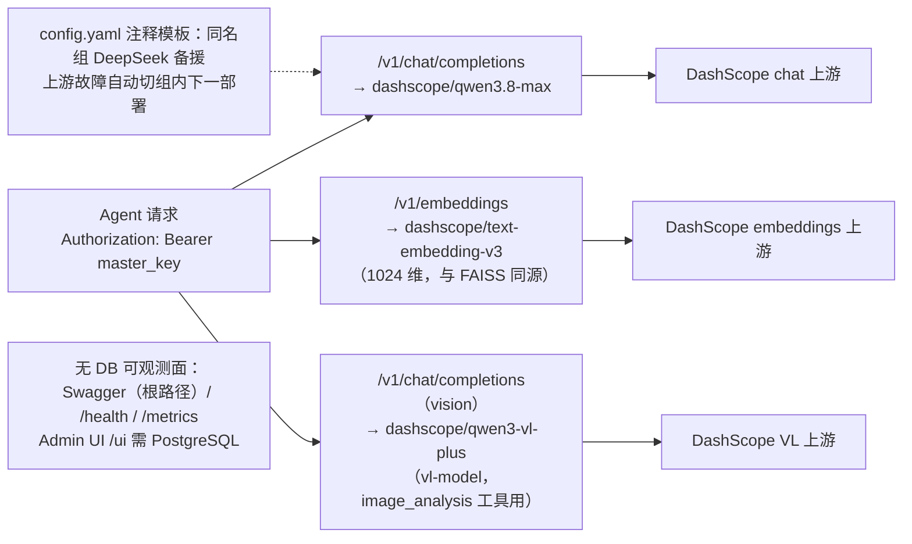

# LLM 网关（LiteLLM Proxy）

把 Agent 的全部 LLM / embedding 流量收敛到本仓库自带的一个 OpenAI 兼容入口。
选择 LiteLLM 的理由：Python 栈亲缘、`dashscope/` 一等支持（含 `/v1/embeddings`）、
YAML 配置即代码、MIT。

## 职责与能力

- 统一 OpenAI 协议入口：换模型只改本目录 `config.yaml` 的 `model_list`，业务侧零代码改动
- 上游 Key 集中管理：`DASHSCOPE_API_KEY` 只配在网关进程，业务侧只拿一把 master key
- 失败重试 / 同名模型可用组：上游欠费（`Arrearage`）、限流时自动组内切换
- 流量日志：token 用量、每请求延迟、成本估算可查（`GET /metrics`、`GET /spend`）



## 硬约束（勿改）

`vectorstore/` 的 FAISS 索引由 DashScope `text-embedding-v3`（1024 维）构建。
`rag_search` 的 embedding 路由**必须**是 `dashscope/text-embedding-v3`
的同名 alias —— 换任何其他 embedding 模型都会报 `assert d == self.d`。

多模态（v2.4）：`vl-model` alias → `dashscope/qwen3-vl-plus`，供
`image_analysis` 工具分析用户图片（本地图 base64 data URI / URL 透传），
不属硬约束，可按需换 VL 型号。**注意：无 DB 模式只认 master key**——
带其他 Bearer 的请求报 `400 No connected db.`（src 侧进程把
`AGENT_API_KEY` 设为 `.master_key` 即可，VL 客户端复用同一凭据）。

## 安装与启动

```powershell
# 网关依赖单独装，不进主 requirements.txt（faiss/akshare 等核心依赖不受影响）
D:\projects\stock-agent\.venv\Scripts\pip.exe install -r requirements.txt

# 一键启动（任意目录可执行）：自动用 venv 绝对路径启动 litellm（裸 `litellm`
# 不在 PATH——不激活 venv 敲了没反应）、生成/复用 master key 到 .master_key、
# 跳过启动期联网拉模型成本表（本机出 raw.githubusercontent.com 被 RST，否则卡住
# 无输出）、NO_PROXY=dashscope.aliyuncs.com 直连（系统代理抖动=连接错误的常因）。
# 幂等：4000 已监听则只提示凭据位置后退出。
powershell -ExecutionPolicy Bypass -File D:\projects\stock-agent\gateway\start-gateway.ps1

# 手动等价方式（在 gateway/ 目录内，依旧需 venv 绝对路径）
$env:DASHSCOPE_API_KEY   = "sk-xxx"     # DashScope key，只给网关进程
$env:LITELLM_MASTER_KEY  = "sk-xxx"     # 自定义，业务侧调用凭据
$env:LITELLM_LOCAL_MODEL_COST_MAP = "True"
& ..\.venv\Scripts\litellm.exe --config config.yaml --port 4000
```

⚠️ 脚本解析坑（实测踩过）：Windows PowerShell 5.1 用系统默认编码（GBK）解析**不带
BOM** 的 .ps1，`start-gateway.ps1` 因此与 `config.yaml` 一样只用英文/ASCII 注释——
在 zh-CN 主机上放中文注释会直接报解析错误、什么都不执行。

网络注意：上游是 DashScope 国内端点，通常直连即可。启动脚本已内置 NO_PROXY；
若手动方式仍受系统代理干扰，先设 `$env:NO_PROXY = "dashscope.aliyuncs.com"`。

⚠️ 编码坑（实测踩过）：LiteLLM 在 Windows 上用系统默认编码（zh-CN 即 GBK）读
`config.yaml`，配置里**任何非 ASCII 内容都会让启动直接崩溃**
（`UnicodeDecodeError: 'gbk' ...`）。所以本目录 `config.yaml` 特意用英文注释；
若要加中文注释，必须给网关进程加 `$env:PYTHONUTF8 = "1"`。

## 业务侧切换到网关（零代码改动）

以下命令在 `gateway/` 目录内执行（`.master_key` 生成在本目录）。

```powershell
$env:AGENT_BASE_URL           = "http://localhost:4000/v1"
$env:AGENT_API_KEY            = (Get-Content .master_key -Raw).Trim()   # 一键脚本方式的凭据来源
$env:AGENT_EMBEDDING_BASE_URL = "http://localhost:4000/v1"
$env:AGENT_MODEL              = "qwen3.8-max"   # 不变

cd D:\projects\stock-agent\src
python agent.py --mode manual --question "茅台2023年毛利率"
```

`AGENT_API_KEY` 的优先级高于 `DASHSCOPE_API_KEY`（src/tools.py 等三处调用点
均为 `getenv("AGENT_API_KEY") or getenv("DASHSCOPE_API_KEY")`），照抄上面四行即可。

## Admin UI / 接口文档

- 管理页：`http://localhost:4000/ui`；API 文档（Swagger）：`http://localhost:4000/`
- 登录：用户名 `admin`（`UI_USERNAME` 默认值），密码 = master key（一键脚本方式即
  `gateway/.master_key` 的值）。LiteLLM 未单独配置 `UI_PASSWORD` 时自动复用 master key。
- ⚠️ 登录**必须连接数据库**（实测：无 DB 时输入正确密码也报
  `Authentication Error, Not connected to DB!`）。无 DB 模式下可用的观察手段：
  根路径 Swagger（直接试调接口）、`/health`、`/metrics`（Prometheus 文本）、启动窗口日志。
  要真正用 UI 的虚拟 Key / 用量明细，需接 PostgreSQL（`general_settings.database_url`）。
- 模型/配置改动依然以 `config.yaml` + 重启为准（配置即代码），UI 仅作观察页。

## 验证

```powershell
# 1) 模型列表可见（curl 是 Invoke-WebRequest 别名，-H 要写成 -Headers 哈希表）
$mk = (Get-Content .master_key -Raw).Trim()
Invoke-RestMethod http://localhost:4000/v1/models -Headers @{ Authorization = "Bearer $mk" }
# 或者用真 curl： curl.exe http://localhost:4000/v1/models -H "Authorization: Bearer $mk"

# 2) embedding 维度断言（1024 维 sanity check）
D:\projects\stock-agent\.venv\Scripts\python.exe -c "
from openai import OpenAI; import os
c = OpenAI(base_url='http://localhost:4000/v1', api_key=open('.master_key').read().strip())
r = c.embeddings.create(model='text-embedding-v3', input='测试')
assert len(r.data[0].embedding) == 1024, len(r.data[0].embedding)
print('embedding dim ok: 1024')"

# 3) 视觉模型 sanity check（v2.4，image_analysis 工具同路径）
# r = c.chat.completions.create(model='vl-model', messages=[{
#     "role": "user",
#     "content": [{"type": "image_url", "image_url": {"url": "https://..."}},
#                 {"type": "text", "text": "图里是什么？"}]}])
```

## 演进路线

- 虚拟 Key / 团队预算硬熔断：需 PostgreSQL 与 `database_url` 配置（当前无 DB 轻量模式）
- DeepSeek 备援：`config.yaml` 末尾的注释模板，同 `model_name` 多条目即组成可用组
